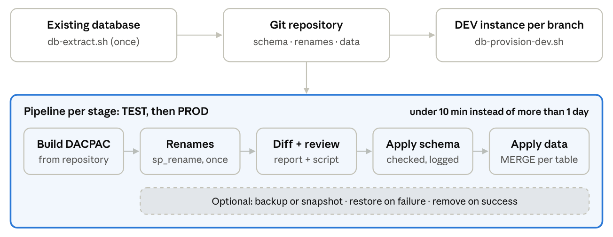

# DIC-DB-as-Code

**From Days to Minutes: Version-Controlled Database Deployment for Data Integration Centers**

DIC-DB-as-Code is an open, platform-independent toolkit of Linux Bash scripts that brings the
**Microsoft SQL Server databases of a medical data integration center (DIC)** under version control
and into CI/CD pipelines. It is built on Microsoft's [SqlPackage](https://learn.microsoft.com/sql/tools/sqlpackage/sqlpackage)
and `sqlcmd` and works with any Git hosting service (Azure DevOps, GitLab, GitHub, Gitea, …) and any
CI system that can run a Bash step.



*An existing database is extracted once into a Git repository. Development instances are provisioned
per branch, and every change passes through the same pipeline for TEST and PROD.*

---

## Why?

Within a DIC, ETL code is usually versioned and deployed automatically – the databases behind it often
are not. Schema changes and configuration tables are scripted by hand, compared between environments
manually and transferred with copy & paste. At our site, promoting such a change from development to
production took **more than one working day**. With this toolkit, it is a pipeline run of
**less than ten minutes** per stage.

## Features

| Area | What you get | Scripts |
|---|---|---|
| **Initial setup** | Extract an existing database into one `.sql` file per object plus an SDK-style SQL project and an initial DACPAC – including references between linked databases | `db-extract.sh`, `db-build.sh` |
| **Provisioning** | Create a complete database (e.g. one DEV database per feature branch) from the repository, optionally with versioned data and test data | `db-provision-dev.sh` |
| **Change deployment** | Compare a target database with the repository, produce a reviewable change script + deployment report + metadata, and execute exactly this script after verification | `db-diff.sh`, `db-apply-diff.sh` |
| **Data-preserving renames** | Rename columns and tables with `sp_rename` *before* the comparison, so SqlPackage does not drop and recreate them | `db-new-rename.sh`, `db-apply-renames.sh` |
| **Backup & rollback** (optional) | Backup or database snapshot before a run, automatic restore on failure, cleanup on success | `db-backup.sh` |
| **Configuration-data versioning** | Version the rows of selected tables (e.g. schemas `conf`, `pc`) as MERGE scripts with one line per record, refresh them from a database and apply them transactionally | `db-data-init.sh`, `db-data-refresh.sh`, `db-data-apply.sh` |
| **Pipelines** | Ready-to-adapt examples for Azure DevOps, GitLab CI and GitHub Actions | `toolkit/examples/pipelines/` |
| **Lab** | Docker Compose lab with three SQL Server 2022 instances (PROD/TEST/DEV) and a tools container to try everything locally | `lab/` |

Design principles:

- **Plain Bash + Microsoft tools** – no proprietary services, no IDE dependency, offline installation possible.
- **Everything is a reviewable text file** – schema objects, rename scripts, configuration data and change scripts.
- **Safe by default** – conservative publish profile, protected databases, data-loss blocking, dry runs, history table that prevents double execution.
- **Composable** – results on STDOUT, logs on STDERR, meaningful exit codes; every script can be chained in any pipeline.

## Repository structure

```
DIC-DB-as-Code/
├── README.md                     ← this file
├── LICENSE                       ← Apache License 2.0
├── docs/                         ← detailed documentation (start here)
│   ├── 01-installation.md
│   ├── 02-concepts.md
│   ├── 03-configuration.md
│   ├── 04-schema-deployment.md
│   ├── 05-renames.md
│   ├── 06-backup.md
│   ├── 07-data-versioning.md
│   ├── 08-pipelines.md
│   ├── 09-lab.md
│   ├── 10-troubleshooting.md
│   └── images/workflow.png
├── toolkit/                      ← what you embed in your database repository
│   ├── scripts/                  ← db-*.sh + lib/ (shared helpers)
│   ├── config/                   ← publish profiles, example.env
│   ├── templates/                ← .sqlproj templates, rename templates
│   └── examples/pipelines/       ← Azure DevOps, GitLab CI, GitHub Actions
└── lab/                          ← Docker lab (PROD/TEST/DEV + tools container)
```

## Documentation

| # | Document | Content |
|---|---|---|
| 1 | [Installation](docs/01-installation.md) | SqlPackage, sqlcmd, .NET SDK on Linux – online and offline; Kerberos; container image |
| 2 | [Concepts and workflow](docs/02-concepts.md) | State- vs. migration-based deployment, the end-to-end workflow, layout of a database repository |
| 3 | [Configuration](docs/03-configuration.md) | Connection variables, env files, secrets, publish profiles, protected databases |
| 4 | [Schema deployment](docs/04-schema-deployment.md) | `db-extract.sh`, `db-build.sh`, `db-provision-dev.sh`, `db-diff.sh`, `db-apply-diff.sh` |
| 5 | [Renames without data loss](docs/05-renames.md) | `db-new-rename.sh`, `db-apply-renames.sh`, naming convention, ordering |
| 6 | [Backup and rollback](docs/06-backup.md) | `db-backup.sh` and the `--backup` option |
| 7 | [Configuration-data versioning](docs/07-data-versioning.md) | `db-data-init.sh`, `db-data-refresh.sh`, `db-data-apply.sh` |
| 8 | [Pipelines](docs/08-pipelines.md) | Stage design, approvals, Azure DevOps / GitLab / GitHub examples |
| 9 | [Lab walkthrough](docs/09-lab.md) | Try everything locally with Docker in about one hour |
| 10 | [Troubleshooting](docs/10-troubleshooting.md) | Known errors and how to fix them |

## Quickstart

### Option A – try it in the lab (Docker)

```bash
git clone https://github.com/Mountainman97/DIC-DB-as-Code.git
cd DIC-DB-as-Code/lab
docker compose up -d --build          # first start takes a few minutes
docker exec -it DIZTOOLS bash         # all toolkit scripts are on the PATH

# inside DIZTOOLS (/workspace)
db-extract.sh --env-file config/prod.env -d DIZ_NET -o database/DIZ_NET --build
db-provision-dev.sh --env-file config/dev.env -d DIZ_NET --project database/DIZ_NET
```

Continue with the [lab walkthrough](docs/09-lab.md).

### Option B – use it with your own databases

1. Install SqlPackage, sqlcmd and the .NET SDK on a Linux machine or build agent ([docs/01-installation.md](docs/01-installation.md)).
2. Add this repository to your database repository, e.g. as a Git submodule:

   ```bash
   git submodule add https://github.com/Mountainman97/DIC-DB-as-Code.git tools/dic-db-as-code
   ```

3. Create an env file per environment from [`toolkit/config/example.env`](toolkit/config/example.env) (without passwords) and export `DB_PASSWORD`.
4. Extract your production database once and commit the result:

   ```bash
   T=tools/dic-db-as-code/toolkit/scripts
   $T/db-extract.sh --env-file config/prod.env -d MY_DB -o database/MY_DB --build
   git add database && git commit -m "Initial import of MY_DB"
   ```

5. Provision a development database, change `.sql` files, open a pull request.
6. Deploy with a pipeline: renames → diff → approval → apply → data ([docs/08-pipelines.md](docs/08-pipelines.md)).

## Requirements at a glance

- Linux with Bash ≥ 4.4 (workstation, build agent or container)
- SqlPackage, sqlcmd (`mssql-tools18` or `go-sqlcmd`), .NET SDK ≥ 8
- Microsoft SQL Server 2016 or later (configuration-data export needs SQL Server 2017+)
- Network access to the SQL Server instances

## Scope and limitations

- Microsoft SQL Server only; other database systems would require other comparison tools.
- Data versioning is intended for configuration and reference data in tables with a primary key, not for clinical data.
- Security objects (users, logins, permissions) are environment-specific and excluded by default.
- Automated tests of database code and zero-downtime deployment are out of scope.

See the individual documents for details.

## Language note

The documentation is in English. Log output and `--help` texts of the scripts are currently in German.

## Citation

If you use this toolkit in academic work, please cite:

> Bergmann M, Krause V,Bathelt F. From Days to Minutes: Version-Controlled Database Deployment for Data Integration Centers. (MIE 2027, submitted.)

## License

[Apache License 2.0](LICENSE)
